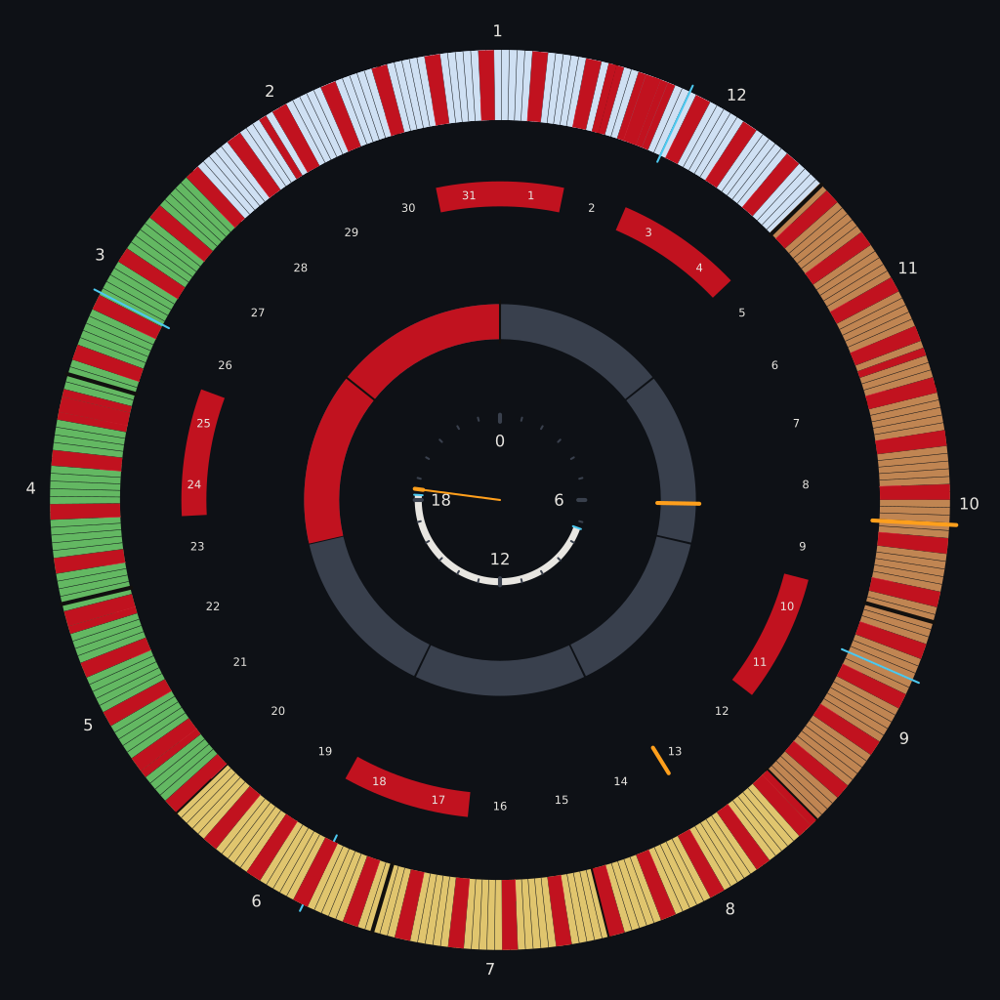

# wycca

A calendar drawn as a set of concentric rings — hours on the inside, the year on
the outside — rendered as flat-coloured SVG. Read it from across the room, or
just watch the clock hand move while you work.



*`config.json` + `holidays-uk.ics`, rendered at 14:30 on 13 October 2026.*

## Overview

### What you get

A ring is one turn of the clock. What lands on it is yours: hours and daylight on
one, the week and its red weekends on the next, the month and its day numbers on
the third, and seasons, month and week ticks, equinoxes, solstices and public
holidays on the outside one. An accent-coloured hand, and a rule across every
ring at once, say where "now" is.

Nothing is fetched and nothing is tracked: the solar marks are computed from a
latitude and longitude you set, the holidays come from an `.ics` file you hand
it, and the result is a picture you can keep.

### Who it is for

Anyone who wants their day and their year visible at a glance — a wallpaper you
read across the room, a clock that also tells you how long the light lasts, a
holiday calendar that does not need an account.

### Platforms

| Target | What it is |
|---|---|
| **Linux CLI** | writes SVG or PNG; point a compositor or `feh` at it for a live wallpaper |
| **Browser** | html, js and wasm files |
| **Android widget** | planned |

All of them render the same core, so they cannot disagree about what a holiday is
or where the solstice is.

> **Alpha.** Early, and the config will change without notice. Nothing here is
> covered by a stability promise.

## Usage

### CLI

Try it without installing

```sh
nix run . -- --png ~/wall.png
```

#### Build and install

With Nix

```sh
nix profile install .
# or:
nix build && ./result/bin/wycca
```

With Cargo

```sh
cargo install --path crates/wycca-cli
# or:
cargo build --release
```

Either way you get one binary, `wycca`. PNG output needs a font: resvg picks up
your system fonts, and on a machine with none, point `WYCCA_FONT` at a `.ttf`.

#### Make a wallpaper

```sh
wycca -f
# render it and open a feh window
wycca --png ~/wall.png && feh --bg-fill ~/wall.png
```

That second line is the wallpaper: run it from cron and the picture keeps itself
current. `wycca --help` lists every flag; `-a 2026-10-13T14:30:00+01:00` renders
a fixed moment instead of now, and the timezone comes from the system.

#### Configuration

The config is JSON, or YAML if the file name ends in `.yaml`/`.yml` — YAML is
CLI-only, because it is the one place a person hand-writes a config and so the
one place comments earn their keep.
[`config.json`](config.json) is a worked example and
[`config.schema.yaml`](config.schema.yaml) is the schema it has to satisfy,
which an editor can autocomplete and check it against:

```jsonc
// .vscode/settings.json
"json.schemas": [{ "fileMatch": ["config.json"], "url": "./config.schema.yaml" }]
```

A ring is a scale plus layers, and a layer says where its spans come from and how
to draw them:

```yaml
- kind: periodic        # solar | ics | now
  unit: day             # year month week day hour minute
  amount: 2             # how long a span is, in units; 0 is an instant
  every: 7              # repeat every n units
  shift: sat            # the phase: a weekday for days, a month for months
  disp:
    background: weekend # a palette slot name or #rrggbb; null for no fill
    border: { kind: line, color: accent, width: 0.004, inner: 0.1 }
    label: { at: in, anchor: middle, color: foreground, size: 0.8 }
    offsets: { inner: 0, outer: 0 }   # trims, in per cent of the ring's thickness
```

That is the whole vocabulary — a tick, a rule between two months, a weekend, a
season, a holiday and the clock hand are the same layer with different numbers.
Every field, and why it exists:
[`config.rs`](crates/wycca-core/src/config.rs).

#### Holidays

Whole-day events come from `.ics`, and only whole-day ones. Google's public
per-country calendars are free and need no key:

```sh
curl -o holidays-uk.ics "https://calendar.google.com/calendar/ical/en-gb.uk%23holiday%40group.v.calendar.google.com/public/basic.ics"
wycca --events holidays-uk.ics --png ~/wall.png
```

`--events` fills the `holidays` feed, which the year ring's holiday layer already
points at, so it needs no configuration to know where the days go.

### Browser

#### Download

A release is a tarball of three files — take
[`wycca-web-<version>.tar.gz`](https://github.com/sirewix/wycca/releases) from the
releases page, unpack it anywhere and open `index.html`: no server, no install,
and it works offline.

#### Build it yourself

With Nix

```sh
nix build .#web && ls result/
```

From a checkout

Needs cargo with the wasm target (`rustup target add wasm32-unknown-unknown`):

```sh
web/build.sh
xdg-open web/index.html
```

`build.sh` emits `web/wycca.wasm` plus a base64 copy of it inlined into
`web/wycca.wasm.js`, so the page runs straight off the disk. Deploying it is
copying the directory to a web server.

Either way you get the same page: an SVG of the rings, and a form for everything
in the config. The form is described by the core, so the page and any future
widget edit exactly the same things.

### Android widget

Planned. Everything it would need is already in the core; nothing is written yet.

## Development

Vibecoded, in that order. [AGENTS.md](AGENTS.md) is the design document and the
honest record of why the code is shaped the way it is — read it before changing
anything, and expect it to disagree with you. The short version: `wycca-core` is
pure — no I/O, no clock, one function, `render(&Config, t_ms) -> String` — so the
CLI, the browser and the widget all share one implementation.

`nix develop` is the toolchain: cargo, clippy, rustfmt, feh, a font, and the two
binaries the wasm build needs.

```sh
nix develop -c cargo test
nix develop -c cargo clippy --all-targets -- -D warnings

cargo test -p wycca-core --features schema   # rewrites config.schema.yaml
```

## License

MIT — see [LICENSE](LICENSE).
